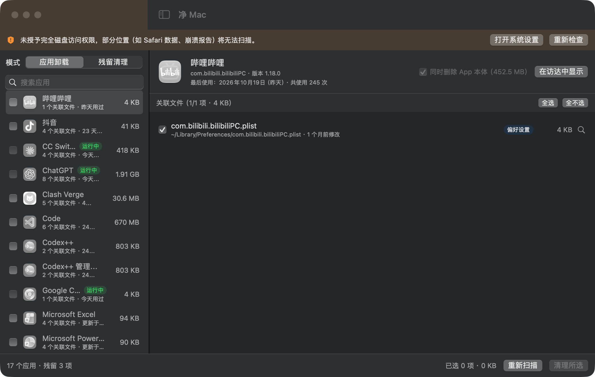
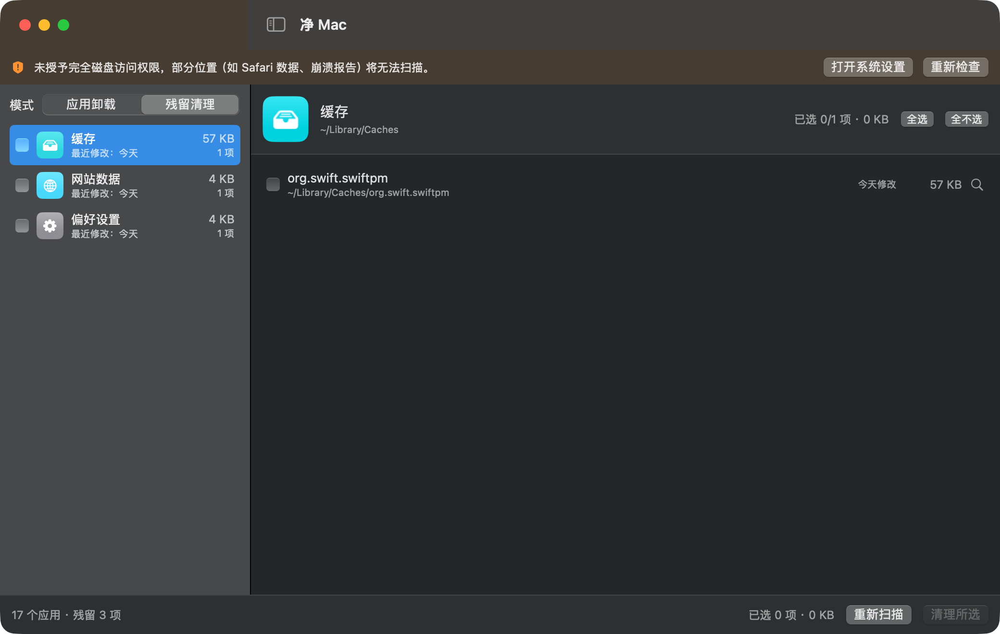

# 净 Mac · CleanMac


> A free, lightweight, native macOS app uninstaller & leftover cleaner. No ads, no subscriptions, no paywalls. (Chinese UI)

一款**完全免费、无广告、无需会员**的 macOS 应用卸载与残留清理工具。

做它的原因很简单：看不惯市面上很多清理工具把"删除自己电脑上的垃圾文件"这种基础功能锁进付费墙——扫描免费、删除收钱，想清理垃圾得先充会员。清理自己的电脑，本来就应该免费。净 Mac 把这类工具的核心能力完整做出来，全部功能零门槛开放。

## 界面预览

| 应用卸载 | 残留清理 |
| --- | --- |
|  |  |

## 为什么选择净 Mac

- **完全免费，无广告无内购**：没有 Pro 版、没有会员、没有"付费解锁完整清理"，所有功能开箱即用
- **轻量化**：原生 SwiftUI 开发，安装包仅约 1.5 MB，零第三方依赖，启动即用，无后台常驻进程，本身几乎不占空间
- **深度检索**：按 Bundle ID + 应用名双重匹配，覆盖缓存、偏好设置、容器、组容器、网站数据、Cookie、启动项、日志、崩溃报告、应用脚本等 16 类系统位置，连 `group.com.xxx`、`团队ID.com.xxx` 这类变体目录也能准确归属
- **完整清除**：卸载 App 时连同它的服务文件一起清，不是只把 `.app` 拖进废纸篓
- **残留清理**：自动找出已卸载 App 留下的"孤儿文件"（残留容器、过期缓存、失效配置），按类别分组，逐项勾选
- **使用记录辅助决策**：显示每个 App 的最后使用日期和使用次数（来自系统 Spotlight 记录），超过 90 天没用的自动橙色标记"久未使用"，卸载谁留谁一目了然

## 安全设计

清理工具最重要的是"不误伤"，净 Mac 在这方面做了多重保护：

- **一律移到废纸篓**，不直接抹除，删错了随时能从废纸篓恢复
- **默认全部不勾选**，选什么删什么，不存在"一键全删"的陷阱
- **系统组件永久保护**：`com.apple.*`、快捷指令等 Apple 组件和已知共享组件（如浏览器自动更新器）永远不进入清理列表
- **精确匹配**：按点分组件匹配 Bundle ID，`com.foo.bar` 不会误伤 `com.foo.barbaz`；同公司仍在安装的 App 的配套组件保守跳过，宁可少报不误删
- **运行中保护**：正在运行的 App 禁止勾选清理
- **拿不准先看**：每个文件都有"在访达中显示"按钮，清理前可以亲眼确认

## 安装

### 方式一：下载成品

从 [Releases](../../releases) 下载 `CleanMac.app`，拖入"应用程序"文件夹即可。

> 首次打开如提示"无法验证开发者"，在访达中**右键 App → 打开**即可。这是因为应用使用 ad-hoc 签名（没有付费的 Apple 开发者证书），源码完全公开，可自行审计或按方式二自行构建。

### 方式二：从源码构建

只需 macOS 命令行工具（CLT），**不需要安装完整 Xcode**：

```bash
xcode-select --install        # 已装过可跳过
git clone https://github.com/Paliwan666/CleanMac.git
cd CleanMac
zsh scripts/package.sh        # 编译并生成 dist/CleanMac.app（含图标与签名）
```

运行自测（32 项匹配逻辑与集成断言）：

```bash
swift run CleanMacSelfTest
```

## 使用提示

- **建议授予"完全磁盘访问权限"**：未授权时部分受保护目录（如 Safari 数据、崩溃报告）无法扫描，大文件夹的体积统计也会偏小。App 顶部会有引导横幅，一键跳转系统设置
- 清理结果页会列出删除失败的项目及原因；删除 `/Applications` 中由管理员安装的 App 本体时，可能需要在访达中手动删除一次以完成授权

## 技术说明

- **技术栈**：Swift 6 + SwiftUI + SwiftPM，零第三方依赖
- **架构**：`CleanMacCore`（扫描/匹配/清理纯逻辑，可独立测试）+ `CleanMac`（SwiftUI 界面）+ `CleanMacSelfTest`（CLT 环境下替代 XCTest 的自测程序）
- **使用记录来源**：macOS Spotlight / LaunchServices 元数据，无需任何权限

```
├── Package.swift
├── Sources
│   ├── CleanMac          # 界面与交互
│   ├── CleanMacCore      # 扫描、匹配、清理核心逻辑
│   └── CleanMacSelfTest  # 自测程序
├── Resources             # Info.plist
├── scripts               # 图标生成、打包脚本
└── docs                  # README 截图
```

## 已知取舍

- 目前只清理用户级 `~/Library`；系统级 `/Library` 需要管理员授权助手，暂未支持
- 已安装 App 的"同公司"组件会被保守跳过（避免误删正在运行的配套进程数据），可能漏掉同厂商已卸载产品的少量残留

## 路线图

- [ ] 深度模式开关（放开同公司残留限制）
- [ ] 系统级 `/Library` 清理（管理员授权）
- [ ] 英文界面
- [ ] 大文件/重复文件清理

## 贡献

欢迎 Issue 和 PR。无论是误判反馈、新的残留位置线索，还是界面改进，都很感谢。

## 开源协议

[MIT](LICENSE) —— 随意使用、修改、分发，保留版权声明即可。
